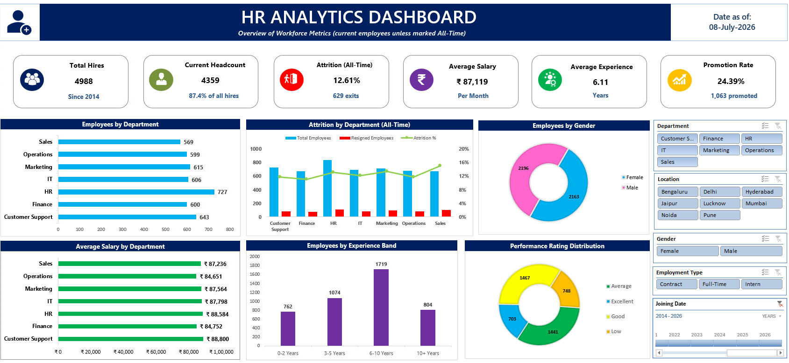

# HR Analytics Dashboard (Excel)

My first dashboard project. It looks at headcount, attrition and pay for a company of about 5,000 employees, built entirely in Excel.

I work in HR operations, and I wanted to see how far I could get with the tools I already use every day: Power Query, pivot tables and formulas.

## What's in the file

| Sheet | What it does |
|---|---|
| Dashboard | KPI cards, six charts, and slicers for department, location, gender, employment type and joining date |
| Business Report | Summary tables, findings and notes on the data |
| Cleaned_Data | The cleaned table everything else runs on (4,988 rows) |
| HR_Master_Data | The raw data, untouched (5,000 rows) |
| KPIs, Pivot Tables, Dept Avg Salary, Department Avg attendance | The calculations behind the dashboard |

Only the first three sheets are visible when you open the file. The rest are hidden to keep it tidy: right-click any sheet tab and choose Unhide to see them.

## About the data

The dataset is AI-generated sample data: 5,000 employee records with 40 fields covering joining and exit dates, salary, performance, attendance and so on. None of it describes real people or a real company. I removed the email and phone columns before uploading anyway.

Being generated data matters for how you read the results. More on that below.

## Cleaning

Done mostly in Power Query, with a few helper columns in Excel:

- Department names were inconsistent (hr, HR Dept, Human Resources), so I merged them into HR
- 118 missing salaries and 116 missing attendance values were filled with the department average
- Attendance above 100% was capped at 100
- Added bands for age, experience, salary, performance and training hours

Two problems took me longer to catch:

**Duplicate IDs.** Eleven employees in the raw data shared the ID EMP00050. My first version removed them as duplicates. They turned out to be eleven different people, and the IDs EMP00099 to EMP00109 were missing from the sequence, so they had simply been entered wrong. I restored them under those IDs and changed the duplicate check to compare whole rows instead of just the ID column.

**Impossible dates.** Twelve people had an exit date before their joining date. There's no way to know the right dates, so I removed them from the cleaned table. They're still in the raw sheet.

## How the main numbers are calculated

This is the part I'd do differently if I started again.

My first dashboard counted everyone who had ever worked there, including people who had left, in the headcount, salary and gender charts. Those views now use active employees only.

I also first showed attrition as 12.6%. That's everyone who ever left divided by everyone ever hired, over twelve years, so it isn't a yearly rate. The usual formula is exits in a year divided by the average headcount that year. On that basis attrition was 3.1% in 2025. Both numbers are in the workbook now, clearly labelled.

## What the data shows

- **Attrition has risen every year since 2021**, from 1.3% to 3.1%. Exits went from 36 to 128 while headcount grew from 2,600 to 4,313.
- **Sales loses the most people** (15.1% all-time against 12.6% overall), but a chi-square test gives p = 0.32, so the gap between departments could just be chance.
- **About a third of exits were retirements or performance exits**, not resignations. Counting every exit as a resignation makes voluntary attrition look worse than it is.
- **Pay hardly changes** by department, grade or experience, and interns earn about the same as full-time staff. In a real company that would need looking into. Here it's a sign of how the data was generated.

## Limitations

- The data is generated, so treat the findings as practice, not as real insights.
- The p-values were calculated in Python and don't update inside the workbook.
- 451 records show more years of experience than the person's age allows. I kept them and flagged it in the report.

## Opening the file

Download `HR_Analytics_Dashboard.xlsx` and open it in desktop Excel (2016 or later). The slicers and timeline don't work in Excel Online or Google Sheets. If Excel shows a security bar, click Enable Content so the pivots can refresh.

## Tools

Excel, Power Query, pivot tables and pivot charts, slicers, a timeline, and formulas like GETPIVOTDATA, COUNTIFS and AVERAGEIFS.

---

Rishu Raj · HR operations, learning HR analytics. Feedback is welcome.
